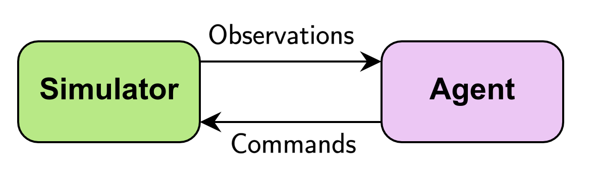
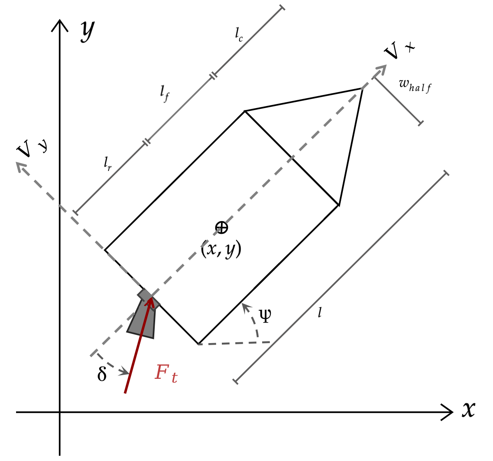
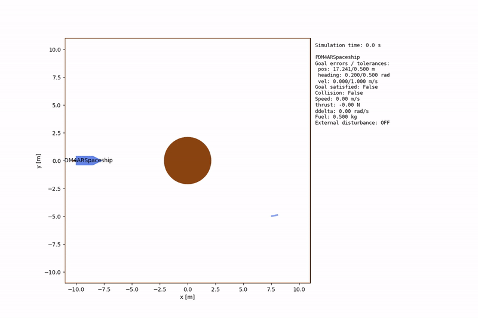
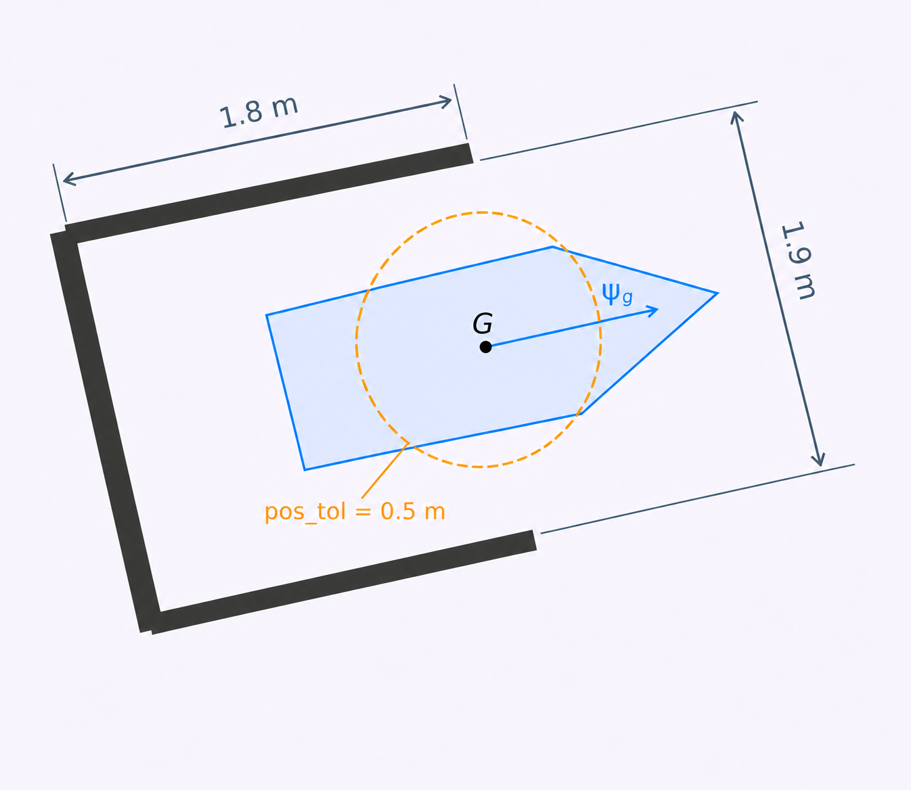
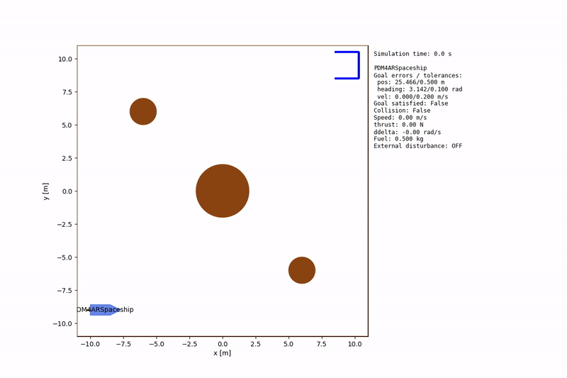
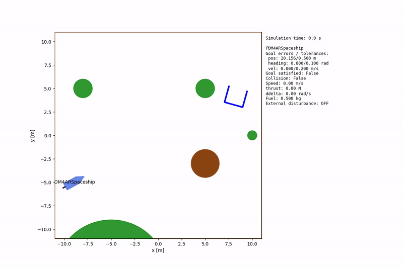
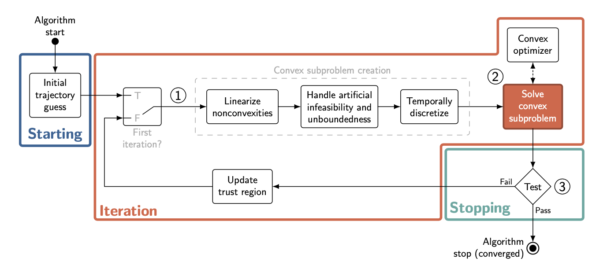

# Exercise 13: Robust Spaceship Docking

Guide a spaceship to a target position, heading and velocity while avoiding planets and moving asteroids. Your solution should be able to handle challenging scenarios such as docking or recovery from external disturbances.

## Your task

Your task is to write the planning stack for the agent.
For testing and evaluation, the agent is then coupled with a simulator in closed-loop.
At each simulation step, the agent receives observations (about its state and other obstacles' state) and it is expected to return actuation commands.



Irrespective of the approach you choose, make sure to preserve the existing `Agent` interface (or it won't work with the
simulator).

You have the freedom to experiment and implement any planning algorithm you deem appropriate.
However, we provide a template to solve the problem adopting a sequential convexification approach.


## Vehicle model

The spaceship moves in a plane using one steerable rear thruster. Its mass changes as fuel is used.



The state and command vectors are:

$$
X = [x, y, \psi, v_x, v_y, \omega, \delta, m]^\top,
\qquad U = [F_t, u_\delta]^\top.
$$

$x,y$ are world-frame coordinates, $\psi$ is the heading, $v_x,v_y$ are **body-frame velocities**, $\omega$ is the spaceship angular velocity, $\delta$ is the thruster angle and $m$ is the total mass. The commands are thrust $F_t$ (`thrust`, in N) and rear steering rate $u_\delta$ (`ddelta`, in rad/s).

### Equations of motion

The nominal dynamics in physical time $t$ are:

$$
\begin{aligned}
\dot{x} &= v_x\cos\psi - v_y\sin\psi, \\
\dot{y} &= v_x\sin\psi + v_y\cos\psi, \\
\dot{\psi} &= \omega, \\
\dot{v}_x &= \frac{F_t}{m}\cos\delta + \omega v_y, \\
\dot{v}_y &= \frac{F_t}{m}\sin\delta - \omega v_x, \\
\dot{\omega} &= -\frac{l_r}{I_z}T\sin\delta, \\
\dot{\delta} &= u_\delta, \\
\dot{m} &= -C_T\,\lvert F_t\rvert.
\end{aligned}
$$

$l_r$ is the distance from the centre of mass to the rear thruster, $I_z$ is the moment of inertia, and $C_T$ is the coefficient in the mass-change equation; fuel is consumed for both positive and negative thrust. Use `sg.l_r`, `sg.Iz` and `sp.C_T` for these parameters. The terms $\omega v_y$ and $-\omega v_x$ arise because velocity is expressed in the rotating body frame.

### Implementing the dynamics

Implement these equations with SymPy in `src/pdm4ar/exercises/ex13/spaceship.py`, using the state and command order above. The template derives the Jacobians from your expression.

The discretizer uses normalized time $\tau = t/t_f \in [0,1]$, with final time $t_f$ stored in `p[0]`. Scale the returned dynamics accordingly:

$$
\frac{dX}{d\tau} = t_f f(X,U),
\qquad \text{where } \frac{dX}{dt} = f(X,U).
$$

After implementing the equations, enable `SolverParameters.check_dynamics` to compare your model with the simulator. The nominal model and physical limits are defined by `SpaceshipModel`, `SpaceshipGeometry` and `SpaceshipParameters` in `dg_commons/sim/models/spaceship.py` and `spaceship_structures.py`; `FuelSpaceshipModel` in `src/pdm4ar/exercises_def/ex13/disturbance.py` changes only the mass equation to use $\lvert F_t\rvert$. 

## Public cases

Your agent will be tested in four different scenarios:

### 1. Reach a position with a given orientation

In this scenario, the spaceship needs to avoid one or multiple planets while trying to arrive at a fixed final goal. 


<video controls controlslist="nodownload" preload="metadata" width="800" style="max-width: 100%; height: auto;" poster="img/ex13_public_1.png" aria-label="Public 1: reaching a target position and orientation">
  <source src="img/ex13_public_1.mp4" type="video/mp4">
</video>



### 2. Enter a dock


The second case introduces docking. A dock consists of a base and two arms around the target pose. All three segments are physical obstacles. The spaceship should enter through the open side and reach the target pose without touching the structure.



The dock is defined relative to the target position and heading. Its base lies behind the target, and two parallel arms extend towards the opening. Its dimensions come from the scenario configuration.
`DockingTarget` in `src/pdm4ar/exercises_def/ex13/goal.py` defines the dock geometry. 

<video controls controlslist="nodownload" preload="metadata" width="800" style="max-width: 100%; height: auto;" poster="img/ex13_public_2.png" aria-label="Public 2: entering a dock">
  <source src="img/ex13_public_2.mp4" type="video/mp4">
</video>



### 3. Dock with moving obstacles


Similar to Scenario 2, but with moving obstacles. Here the moving osbtacles are asteroids with linear trajectories.

Asteroids are circular `DynObstacleModel` objects created in `utils_config.py`. Velocity is expressed in each asteroid's local frame, so its orientation determines the direction of motion in the world frame.


### 4. Dock with moving obstacles and a disturbance

The fourth case tests your controller's ability to replan by adding a disturbance during the flight.

`DisturbedSpaceshipModel` in `disturbance.py` adds a burst of linear and angular acceleration to the spaceship dynamics simulator, which is sampled from a Gaussian distribution with mean and variance specified in each yaml scenario.

The sampled accelerations stay constant for `duration` seconds from `start_time`.


Please be aware that private cases might use different timings and strengths, but still in compatible ranges with the provided example. 


<video controls controlslist="nodownload" preload="metadata" width="800" style="max-width: 100%; height: auto;" poster="img/ex13_public_3.png" aria-label="Public 3: docking with moving asteroids; the spaceship turns red during the disturbance from 2.5 to 5 seconds">
  <source src="img/ex13_public_3.mp4" type="video/mp4">
</video>




## Constraints

There are several constraints that need to be satisfied, [$x_0, y_0$] is the starting location and [$x_1, y_1$] is the goal location:

- The initial and final inputs needs to be zero: $U(t_0) = U(t_f) = 0$
- The satellite needs to arrive close to the goal
    - $\left\lVert \begin{bmatrix} x(t_f) \\ y(t_f) \end{bmatrix} - \begin{bmatrix} x_{\text{1}} \\ y_{\text{1}}
      \end{bmatrix} \right\rVert _{2} < \text{pos\_tol}$
- with a specified orientation.
    - $\left\lVert \psi(t_f) - \psi_{\text{1}} \right\rVert _{1} < \text{dir\_tol}$
- The satellite needs to arrive with a specified velocity.
    - $\left\lVert \begin{bmatrix} v_x(t_f) \\ v_y(t_f) \end{bmatrix} - \begin{bmatrix} v_{x,1} \\ v_{y,1}
      \end{bmatrix} \right\rVert _{2} < \text{vel\_tol}$
- The satellite needs to dodge every obstacle in its path: $(x, y) \bigoplus \mathcal{X}_{Rocket}(\psi) \notin Obstacle
  \quad \forall Obstacle \in Obstacles$, while remaining within the map bounds.

- Respect the following bounds throughout the trajectory. All bounds, including the dry mass $m_v$, are available in the spaceship parameters `sp`.

  | Quantity | Constraint |
  | :--- | :---: |
  | Thrust | $T_{\min}\leq T(t)\leq T_{\max}$ |
  | Thruster angle | $\delta_{\min}\leq\delta(t)\leq\delta_{\max}$ |
  | Thruster steering rate | $u_{\delta,\min}\leq u_\delta(t)\leq u_{\delta,\max}$ |
  | Body-frame velocity | $v_{\min}\leq v_x(t),v_y(t)\leq v_{\max}$ |
  | Mass | $m(t)\geq m_v$ |

- You have a maximum time to reach the goal position: $t_f \leq 60 \ s$ 

## Data Structures

The main data structures used in this exercise are defined in the following files:

- `SpaceshipState` and `SpaceshipCommands`: `dg_commons/sim/models/spaceship.py`
- `SpaceshipGeometry` and `SpaceshipParameters`: `dg_commons/sim/models/spaceship_structures.py`
- `AsteroidParams` and `PlanetParams`: `src/pdm4ar/exercises_def/ex13/utils_params.py`
- `SpaceshipTarget` and `DockingTarget`: `src/pdm4ar/exercises_def/ex13/goal.py`


## Code structure

| File | Role |
| --- | --- |
| `agent.py` | Interface between your solution and the simulator. Use `on_episode_init` to initialize your agent and `get_commands` to compute control commands from simulator observations. |
| `planner.py` | Planning and control logic. Adapt this file to implement your chosen method for reaching the goal while satisfying the task constraints. |
| `spaceship.py` | Vehicle dynamics. Implement the equations of motion needed by your method. |
| `discretization.py` | Provided zero-order and first-order hold utilities for discretizing and integrating the vehicle dynamics, which you may use in your implementation. |

You are free to choose your planning and control approach and adapt the internal code structure accordingly. You will find an initial code skeleton and helpers that are tailored to a solution that leverages SCvx as the reference solution (see Hints). Preserve the `SpaceshipAgent` class and its simulator interface.

At episode start, the agent receives the initial state, goal and environment. During flight, the simulator calls `get_commands` every **0.1 s of simulated time**. At each call, your agent receives observations and returns thrust and steering-rate commands. You may use these observations to update your plan or control strategy as needed (see Hints).


## Evaluation Metrics

The quality of the satellite's trajectory is evaluated based on several key factors. The following list describes the metrics in order of priorities:

1.1. **No Collision** You neither leave the designated boundary nor collide with any obstacle.

1.2. **Mission Accomplishment** You reach the goal region.

2.1. **Time Taken To Reach the Goal:** The time taken to reach the goal.

2.2. **Distance travelled:** The length of the taken trajectory.

2.3. **Actuation effort:** The average of the absolute value of the thrusters' force.

2.4. **The precision of the planner:** Distance to the goal at the end of the episode.

2.5. **Planning Efficiency:** We consider the average time spent in the "get_commands" method as a proxy for efficiency
   and quality of the planner.

The metric is a weigthed sum of the different metrics mentionned above with 1000 being the maximum. Note that it is theoretically impossible to reach full score as we penalise computation time and actualtion effort which are by definition none zero if the mission is accomplished (but can be optimized). You can verify more precisely the function computing the final score in  `src/pdm4ar/exercises_def/ex13/perf_metrics.py`.

Your solution will be tested on the server on a total of eight test cases, two per each scenario introduced above.

As a reference, the TA solution receives the following score on the private test cases:

| Scenario            | Score       |
|---------------------|-------------|
| Average             |     873.53  |
| Scenario 1          |     891.98  |
| Scenario 2          |     874.90  |
| Scenario 3          |     853.70  |

Use these numbers as a guideline to understand the order of magnitude of expected performance for a descently optimized solution.

## Run your implementation

From the student repository, in the configured Python environment:

```bash
python src/pdm4ar/main.py -e 13
```

Select public cases in `src/pdm4ar/exercises_def/ex13/get_config.py`. The report at **`out/13/index.html`** contains videos and state/command plots. You can create local YAML cases to test other conditions.

Submit your code in `src/pdm4ar/exercises/ex13/`. Keep the simulator, evaluation code and official test configurations unchanged in your submission.


## Hints

### Successive convexification

We developed the exercises based on the following
paper ([Convex Optimisation for Trajectory Generation](https://arxiv.org/pdf/2106.09125.pdf)) on SCvx, the planning method used in 2021 by SpaceX to land their spaceship on a moving platform in the middle of the ocean. We recommend to use such a method to solve the problem, but you are free to come up with your own solution.

Starting from a guess for the states and commands, SCvx linearizes and discretizes the dynamics and approximates the nonconvex constraints around that guess. A convex solver computes a new trajectory, which becomes the reference for the next iteration. A **trust region** limits each update to keep the approximation useful. The process repeats until the convergence criteria are met.




For an introduction to SCvx and its use in trajectory generation, see the [tutorial by Malyuta et al.](https://arxiv.org/abs/2106.09125). The [paper by Mao et al.](https://arxiv.org/abs/1804.06539) develops the algorithm and its convergence analysis.

We strongly suggest to read at least the pages 26 to 37 to understand the whole setting of SCvx.
We also recommand to read the previous 25 pages for better understanding of the underlying concepts of SPC algorithms (especially figure 11). You will also find an example of a theoritical application pages 47 to 52. 
We might have forgotten to mention important pages, we thus strongly encourage you to explore the rest of the paper by yourself.

### Replanning

Replanning can help recover from disturbances or large tracking errors. Compute a new trajectory from the observed state, either periodically or when tracking error grows. You can combine replanning with feedback control. Check that a new trajectory is feasible before replacing the current one.

Start each new plan from the current state, and preserve continuity with the commands being applied and the obstacles.

### Simulation time and planning time

Use simulation timestamps for returned trajectories: an **8 s** plan starting at **12 s** covers **12–20 s**, with `p[0] = 8`. Moving obstacles and disturbance intervals follow the same episode clock, and the mission must still finish by **60 s**.

The simulation pauses during agent callbacks. Computation in `get_commands`, including replanning, counts towards the score's runtime penalty; initial planning in `on_episode_init` is excluded from that penalty. The wall-clock evaluation timeout still applies.


### Plotting

You can adapt the plots for local debugging. Set `Config.PLOT = True` in `src/pdm4ar/exercises/ex13/agent.py` to compare planned and executed trajectories. The helper `plot_traj` in `src/pdm4ar/exercises_def/ex13/utils_plot.py` updates `out/13/index.html_resources/final_traj.png` during the simulation; you can extend it with your own diagnostics.

To change the video, edit `create_diagnostic_animation` in `visualization.py`. Report plots are assembled by `_ex13_vis` in `ex13.py`. Both files are in `src/pdm4ar/exercises_def/ex13/`. Changes to these visualization helpers are for local debugging and are not part of your submission.

## References

1. **Malyuta et al. (2021), [Convex Optimization for Trajectory Generation](https://arxiv.org/abs/2106.09125).** Tutorial on trajectory optimization, SCvx and discretization.
2. **Mao, Szmuk, Xu and Açıkmeşe (2018, revised 2019), [Successive Convexification: A Superlinearly Convergent Algorithm for Non-convex Optimal Control Problems](https://arxiv.org/abs/1804.06539).** The SCvx algorithm and its convergence analysis.
3. **Rawlings, Mayne and Diehl, [Model Predictive Control: Theory, Computation, and Design](https://sites.engineering.ucsb.edu/~jbraw/mpc/), 2nd edition.** Feedback control and planning from the current state under constraints.