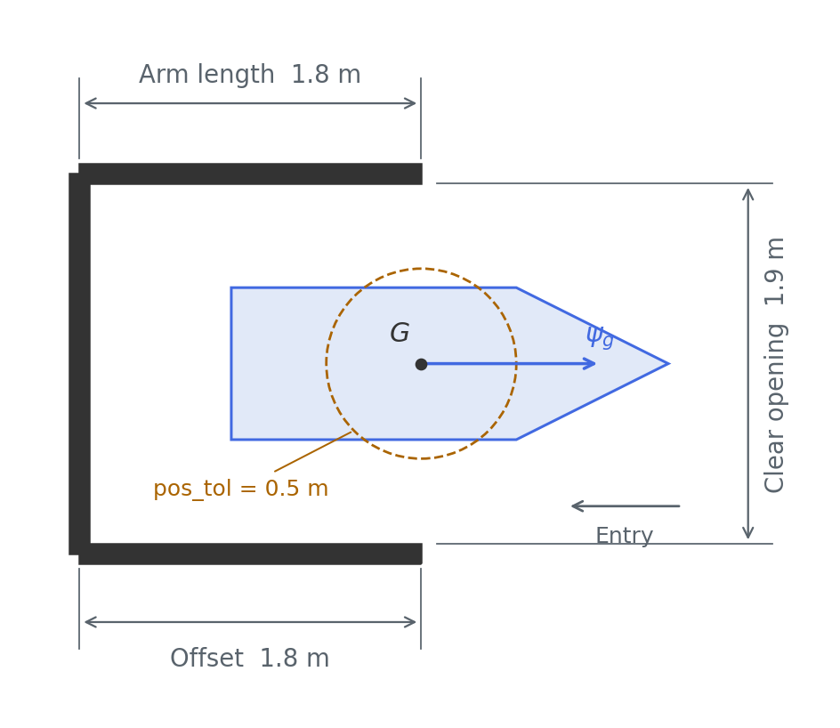
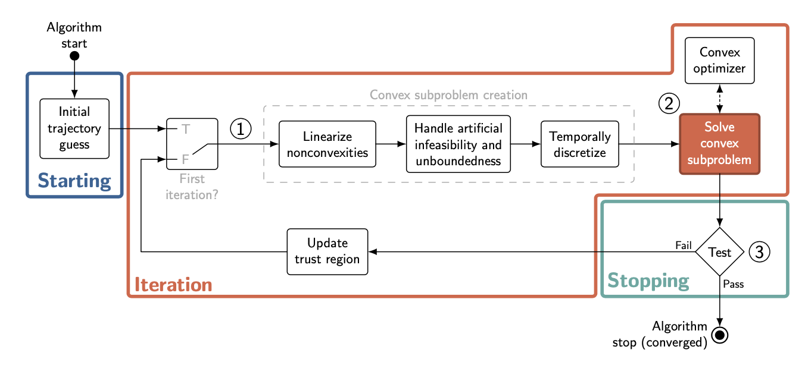

# Exercise 13: Robust Spaceship Docking

Guide a spaceship to a target position, heading and velocity while avoiding planets and moving asteroids. Some missions require docking or recovery from external disturbances.

## Your task

Implement the planning and control agent in `src/pdm4ar/exercises/ex13/`. Compute a feasible trajectory from the supplied state to the goal, then use simulator observations to follow it and correct deviations.

The template includes a **successive convexification (SCvx)** skeleton. You may use another planning method. Preserve the `SpaceshipAgent` class name and the simulator interface.

## Code structure

| File | Role | Your work |
| --- | --- | --- |
| `agent.py` | Simulator interface. | Initialize the plan in `on_episode_init`; use observations in `get_commands` to track it and replan when needed. |
| `planner.py` | Trajectory planning. | Define the objective and constraints, complete `compute_trajectory`, and return timestamped state and command sequences. |
| `spaceship.py` | Nominal vehicle dynamics. | Implement the equations in `SpaceshipDyn.get_dynamics()` using SymPy and final-time scaling. Jacobians are computed automatically. |
| `discretization.py` | Discretization and integration. | Use the supplied zero-order/first-order hold methods and dynamics check. These are already implemented. |

At episode start, the agent receives the state, goal and environment and requests a trajectory from the planner. During flight, the simulator calls `get_commands` every **0.1 s of simulated time**. The agent returns a command; the simulator advances the motion and returns new observations.

## Vehicle model

The spaceship moves in a plane using one steerable rear thruster. Its mass changes as fuel is used.


The state and command vectors are:

$$
X = [x, y, \psi, v_x, v_y, \omega, \delta, m]^\top,
\qquad U = [T, u_\delta]^\top.
$$

$x,y$ are world-frame coordinates, $\psi$ is the heading, $v_x,v_y$ are **body-frame velocities**, $\omega$ is the angular velocity, $\delta$ is the thruster angle and $m$ is the total mass. The commands are thrust $T$ (`thrust`, in N) and steering rate $u_\delta$ (`ddelta`, in rad/s).

### Equations of motion

The nominal dynamics in physical time $t$ are:

$$
\begin{aligned}
\dot{x} &= v_x\cos\psi - v_y\sin\psi, \\
\dot{y} &= v_x\sin\psi + v_y\cos\psi, \\
\dot{\psi} &= \omega, \\
\dot{v}_x &= \frac{T}{m}\cos\delta + \omega v_y, \\
\dot{v}_y &= \frac{T}{m}\sin\delta - \omega v_x, \\
\dot{\omega} &= -\frac{l_r}{I_z}T\sin\delta, \\
\dot{\delta} &= u_\delta, \\
\dot{m} &= -C_T T.
\end{aligned}
$$

$l_r$ is the distance from the centre of mass to the rear thruster, $I_z$ is the moment of inertia, and $C_T$ is the coefficient in the mass-change equation. Use `sg.l_r`, `sg.Iz` and `sp.C_T` for these parameters. The terms $\omega v_y$ and $-\omega v_x$ arise because velocity is expressed in the rotating body frame.

### Implementing the dynamics

Implement these equations with SymPy in `SpaceshipDyn.get_dynamics()` in `src/pdm4ar/exercises/ex13/spaceship.py`, using the state and command order above. The template derives the Jacobians from your expression.

The discretizer uses normalized time $\tau = t/t_f \in [0,1]$, with final time $t_f$ stored in `p[0]`. Scale the returned dynamics accordingly:

$$
\frac{dX}{d\tau} = t_f f(X,U),
\qquad \text{where } \frac{dX}{dt} = f(X,U).
$$

After implementing the equations, enable `SolverParameters.check_dynamics` to compare your model with the simulator. The nominal model and physical limits are defined by `SpaceshipModel`, `SpaceshipGeometry` and `SpaceshipParameters` in `dg_commons/sim/models/spaceship.py` and `spaceship_structures.py`.

## Public cases

The three public test cases introduce the task in stages. The private evaluation follows the same progression with different configurations. The videos below show the reference solution on the public cases.

### 1. Reach a position with a given orientation

In the first case, navigate around a planet and reach the target position with the required heading and translational velocity. Plan the path, turn and arrival speed together.

<video controls controlslist="nodownload" preload="metadata" width="800" style="max-width: 100%; height: auto;" poster="img/ex13_public_1.png" aria-label="Public 1: reaching a target position and orientation">
  <source src="img/ex13_public_1.mp4" type="video/mp4">
</video>

### 2. Enter a dock

The second case introduces docking. A dock consists of a base and two arms around the target pose. All three segments are physical obstacles. Enter through the open side and reach the target pose without any part of the spaceship touching the structure.

The dock is defined relative to the target position and heading. Its base lies behind the target, and two parallel arms extend towards the opening. Its dimensions come from the scenario configuration.

`DockingTarget` in `src/pdm4ar/exercises_def/ex13/goal.py` defines the dock geometry. The loader in `utils_config.py` adds it to the scenario as a `StaticObstacle` for collision checking.



In this case, you must navigate between the planets and land safely inside the dock.

<video controls controlslist="nodownload" preload="metadata" width="800" style="max-width: 100%; height: auto;" poster="img/ex13_public_2.png" aria-label="Public 2: entering a dock">
  <source src="img/ex13_public_2.mp4" type="video/mp4">
</video>

### 3. Dock with moving obstacles and a disturbance

The third case adds moving asteroids and a disturbance during the flight.

Asteroids are circular `DynObstacleModel` objects created in `utils_config.py`. Their YAML entries specify `start`, `radius`, `velocity` and `orientation`; the agent receives these through `AsteroidParams`. Zero acceleration commands and zero angular velocity produce straight paths at constant speed. Velocity is expressed in each asteroid's local frame, so its orientation determines the direction of motion in the world frame.

`DisturbedSpaceshipModel` in `disturbance.py` adds a burst of linear and angular acceleration. A seeded generator draws two independent world-frame linear acceleration components and one angular acceleration from zero-mean Gaussian distributions, **once per episode**. `linear_acc_sigma` sets the standard deviation per linear axis [m/s²]; `angular_acc_sigma` sets the angular standard deviation [rad/s²]. The same seed reproduces the same sample.

The sampled accelerations stay constant for `duration` seconds from `start_time`. The linear acceleration is rotated into the spaceship's body frame before being added to its dynamics. After the burst, the extra acceleration is zero, but the resulting position and velocity deviations remain.

Public case 3 uses the following configuration, active for **$2.5 \leq t < 5.0$ s**:

```yaml
dynamics_disturbance:
  start_time: 2.5
  duration: 2.5
  linear_acc_sigma: 0.15
  angular_acc_sigma: 0.03
  seed: 6508
```

Cases 1 and 2 have no disturbance. Omit this block or set it to `null` to disable the burst. Private cases can use different timings and strengths; the agent receives the observed state without a disturbance schedule. Please experiment with different start times, durations, strengths and seeds in local tests, and make your solution robust to them.

The spaceship is **red during the disturbance** in the video and blue otherwise.

<video controls controlslist="nodownload" preload="metadata" width="800" style="max-width: 100%; height: auto;" poster="img/ex13_public_3.png" aria-label="Public 3: docking with moving asteroids; the spaceship turns red during the disturbance from 2.5 to 5 seconds">
  <source src="img/ex13_public_3.mp4" type="video/mp4">
</video>

## Successive convexification

Nonlinear dynamics and obstacle constraints make trajectory planning nonconvex. SCvx improves a candidate trajectory by solving a sequence of convex approximations.

Starting from a guess for the states and commands, SCvx linearizes and discretizes the dynamics and approximates the nonconvex constraints around that guess. A convex solver computes a new trajectory, which becomes the reference for the next iteration. A **trust region** limits each update to keep the approximation useful. The process repeats until the convergence criteria are met.



The planner contains the outline of this process. `discretization.py` provides zero-order and first-order hold methods. The agent uses the resulting trajectory as a reference during flight.

For an introduction to SCvx and its use in trajectory generation, see the [tutorial by Malyuta et al.](https://arxiv.org/abs/2106.09125). The [paper by Mao et al.](https://arxiv.org/abs/1804.06539) develops the algorithm and its convergence analysis.

## Constraints

The trajectory must satisfy the vehicle dynamics and the following constraints. Let $t_f$ be the arrival time, $X_0$ the initial state, and $(x_g,y_g,\psi_g,v_{x,g},v_{y,g})$ the target.

### Initial and final conditions

Start from the supplied state, with zero commands at the beginning and end of the mission:

$$
X(0)=X_0, \qquad U(0)=U(t_f)=0.
$$

### Goal position, orientation and velocity

At arrival, all three goal conditions must hold at the same time:

$$
\begin{aligned}
\left\|\begin{bmatrix}x(t_f)-x_g\\y(t_f)-y_g\end{bmatrix}\right\|_2
&< \texttt{pos\_tol}, \\
\left|\operatorname{wrap}_{[-\pi,\pi]}\!\left(\psi(t_f)-\psi_g\right)\right|
&< \texttt{dir\_tol}, \\
\left\|\begin{bmatrix}v_x(t_f)-v_{x,g}\\v_y(t_f)-v_{y,g}\end{bmatrix}\right\|_2
&< \texttt{vel\_tol}.
\end{aligned}
$$

Use the tolerances supplied by the goal. Heading error is measured modulo $2\pi$, and velocity components are in the body frame.

### Collision avoidance and map boundaries

The **entire spaceship footprint** must stay inside the map and avoid planets, moving asteroids and all three dock segments throughout the flight, including between planning nodes. Account for the asteroids' positions at the time the spaceship passes them. During docking, pass through the opening without touching the structure.

### Vehicle and actuator limits

Respect the supplied bounds throughout the trajectory:

| Quantity | Constraint | Parameter |
| --- | --- | --- |
| Thrust | $T_{\min}\leq T(t)\leq T_{\max}$ | `sp.thrust_limits` |
| Thruster angle | $\delta_{\min}\leq\delta(t)\leq\delta_{\max}$ | `sp.delta_limits` |
| Thruster steering rate | $u_{\delta,\min}\leq u_\delta(t)\leq u_{\delta,\max}$ | `sp.ddelta_limits` |
| Body-frame velocity components | $v_{\min}\leq v_x(t),v_y(t)\leq v_{\max}$ | `sp.vx_limits` |
| Mass | $m(t)\geq m_v$ | `sp.m_v` (dry mass) |

### Mission time

Reach the goal within **60 s of simulated time**:

$$
0<t_f\leq 60\ \mathrm{s}.
$$

Time is measured from the start of the episode. This is separate from the wall-clock evaluation timeout.

## Evaluation

The score rewards reaching the goal and penalizes collisions, mission duration, distance travelled, final position error, mean absolute thrust and computation time. Initial planning is excluded from the computation-time term; work in `get_commands`, including replanning, is included.

The overall score is the mean across test cases. See `src/pdm4ar/exercises_def/ex13/perf_metrics.py` for the exact rule.

## Run your implementation

From the student repository, in the configured Python environment:

```bash
python src/pdm4ar/main.py -e 13
```

Select public cases in `src/pdm4ar/exercises_def/ex13/get_config.py`. The report at **`out/13/index.html`** contains videos and state/command plots. You can create local YAML cases to test other conditions.

Submit your code in `src/pdm4ar/exercises/ex13/`. Keep the simulator, evaluation code and official test configurations unchanged in your submission.

## References

1. **Malyuta et al. (2021), [Convex Optimization for Trajectory Generation](https://arxiv.org/abs/2106.09125).** Tutorial on trajectory optimization, SCvx and discretization.
2. **Mao, Szmuk, Xu and Açıkmeşe (2018, revised 2019), [Successive Convexification: A Superlinearly Convergent Algorithm for Non-convex Optimal Control Problems](https://arxiv.org/abs/1804.06539).** The SCvx algorithm and its convergence analysis.
3. **Rawlings, Mayne and Diehl, [Model Predictive Control: Theory, Computation, and Design](https://sites.engineering.ucsb.edu/~jbraw/mpc/), 2nd edition.** Feedback control and planning from the current state under constraints.

## Hints

### Replanning

Replanning can help recover from disturbances or large tracking errors. Compute a new trajectory from the observed state, either periodically or when tracking error grows. You can combine replanning with feedback control. Check that a new trajectory is feasible before replacing the current one.

Start each new plan from the current state, including velocity, thruster angle and mass, and preserve continuity with the commands being applied.

### Simulation time and planning time

Use simulation timestamps for returned trajectories: an **8 s** plan starting at **12 s** covers **12–20 s**, with `p[0] = 8`. Moving obstacles and disturbance intervals follow the same episode clock, and the mission must still finish by **60 s**.

The simulation pauses during agent callbacks. Computation in `get_commands`, including replanning, counts towards the score's runtime penalty; initial planning in `on_episode_init` is excluded from that penalty. The wall-clock evaluation timeout still applies.

### Create local test cases

Copy a public YAML file to a new name, such as `config_custom.yaml`, in `src/pdm4ar/exercises_def/ex13/`. Add the name to the list in `get_config.py` and run the exercise. `config_local.yaml` documents the available fields.

Vary the initial state, translate and rotate the dock, and change asteroid positions and velocities. Try different disturbance start times, durations, strengths and seeds. Build docking constraints from the supplied geometry so they follow the goal pose. Inspect complete runs and check the executed trajectory and clearance of the whole spaceship.
