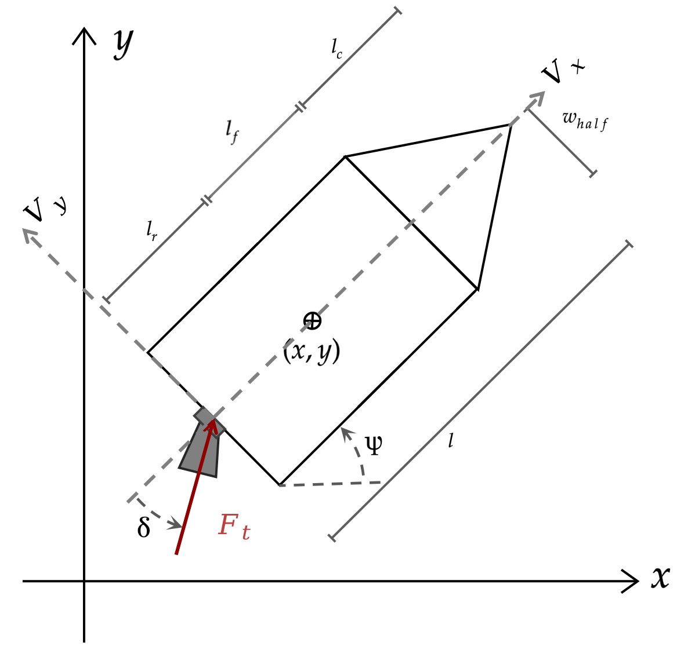

# Exercise 13: Robust Spaceship Docking

Build an autonomous agent that guides a spaceship to a target pose and velocity while avoiding obstacles. Your agent must work in closed loop: it receives the simulated state and returns commands throughout the mission.

The exercise has three public scenarios and six private scenarios. The public cases introduce docking around stationary planets and moving obstacles, with optional external disturbances. The private cases vary the initial conditions, geometry and obstacle motion, and some include external disturbances. Your implementation must handle the scenario data supplied at runtime rather than a specific map or recorded trajectory.

## What you must implement

Complete the student code in `src/pdm4ar/exercises/ex13/`.

| File | Your responsibility |
| --- | --- |
| `spaceship.py` | Implement the nominal vehicle dynamics in `SpaceshipDyn.get_dynamics()`, using the state, input and time conventions below. The template derives the Jacobians from this expression. |
| `planner.py` | Produce a dynamically feasible state trajectory and command sequence from the supplied initial state to the goal, respecting the vehicle and environment constraints. |
| `agent.py` | Connect planning to the simulator: initialize the agent, follow the trajectory and respond to changes in the observed state during the mission. |
| `discretization.py` | Provided integration and discretization utilities. Understand their inputs, outputs and time convention before using them. |

Preserve the `SpaceshipAgent` class name, callback signatures and simulator data types. You may add helpers and internal parameters. The provided planner contains an SCvx skeleton, but you may use another planning method that satisfies the same requirements.

The task is to implement your own planning and control stack. The reference trajectories and videos below illustrate successful behaviour; reproducing their exact path is not required.

## Vehicle model and conventions

The spaceship moves in a plane and has one steerable rear thruster. Its orientation, steering angle and changing mass affect its motion.



The state and command ordering are

$$
X = [x, y, \psi, v_x, v_y, \omega, \delta, m]^\top,
\qquad U = [T, u_\delta]^\top.
$$

| Quantity | Meaning and convention |
| --- | --- |
| `x`, `y` | Position in the world frame [m]. |
| `psi` | Heading of the body frame relative to the world frame [rad]. |
| `vx`, `vy` | Translational velocity components in the **body frame** [m/s]. |
| `dpsi` ($\omega$) | Angular velocity [rad/s]. |
| `delta` | Thruster steering angle relative to the body frame [rad]. |
| `m` | Vehicle mass, including remaining fuel [kg]. |
| `thrust` ($T$) | Signed thrust command [N]. |
| `ddelta` ($u_\delta$) | Rate of change of the steering angle [rad/s], despite its name. |

Use the supplied geometry and physical parameters rather than hard-coding them. The authoritative model and limits are `SpaceshipModel` and `SpaceshipState` in `dg_commons/sim/models/spaceship.py`, and `SpaceshipGeometry` and `SpaceshipParameters` in `spaceship_structures.py`.

The supplied planning interface uses normalized time $\tau \in [0,1]$ and a final-time parameter `p[0]`. The dynamics returned to the discretizer must describe the derivative with respect to normalized time, including the corresponding final-time scaling. The simulator itself uses physical seconds. The provided dynamics check compares the nominal model with the simulator; it is a debugging aid, not a graded task by itself.

## Scenarios and goals

The public cases are selected from `src/pdm4ar/exercises_def/ex13/`.

| Public case | Goal | Environment |
| --- | --- | --- |
| `config_1_public.yaml` | Static target pose and velocity. | One planet; no moving obstacles or disturbance. |
| `config_2_public.yaml` | Docking. | Two planets; no moving obstacles or disturbance. |
| `config_3_public.yaml` | Docking. | One planet, four moving asteroids and a configured external disturbance. |

### Static target

A `SpaceshipTarget` specifies the desired position, heading and translational velocity. Reaching the target position alone is insufficient: all three tolerances must be satisfied at the same time. This goal type has no dock structure; public case 1 uses this goal type.

### Docking target

A `DockingTarget` adds a dock with a base and two arms. Reach the configured pose and velocity while respecting the dock geometry and opening. The spaceship has a finite outline, so a collision-free centre point does not by itself guarantee sufficient clearance.

The base and both arms are physical collision obstacles, using the same geometry as the video. The dock dimensions come from the scenario: its opening width is `2 * (pos_tolerance + add_land_space)`, its arm length is `pos_tolerance + arms_length`, and `offset` places the base behind the target along its heading. The current public docking goals use a 2 m opening, 1.8 m arms and a 1.8 m base offset. `DockingTarget.get_landing_constraint_points()` exposes its geometry. Inspect the goal object and the scenario obstacles rather than assuming a fixed dock position, heading or size. `DockingTarget` is a subclass of `SpaceshipTarget`, but it requires the additional geometric constraints.

### Moving obstacles and disturbances

Planets are stationary circular obstacles. Asteroids are circular obstacles with prescribed constant motion; their initial position, orientation, local-frame velocity and radius are supplied through `AsteroidParams`. Account for their position at the time the spaceship passes them, including when planning after the start of the episode.

Scenarios can apply a short external acceleration disturbance through the optional `dynamics_disturbance` YAML block. During its activation interval, a sampled linear acceleration in the world frame and a sampled angular acceleration are held constant. These accelerations affect the simulation but are not additional commands available to your agent. Your nominal dynamics should remain the supplied vehicle model; use the observed state to handle departures from a planned trajectory. Do not assume that every scenario has a disturbance or that its timing and magnitude are known to the agent.

The six private cases cover the same navigation, docking and obstacle-handling requirements with different configurations. They are not additional implementation tasks, and their maps and recordings are not distributed with the student exercise.

## Simulator interface

The simulator integrates the motion with a 0.01 s timestep and requests a new command every 0.1 s of simulated time.

| Entry point | Information available | Required behaviour |
| --- | --- | --- |
| `SpaceshipAgent.__init__` | Initial vehicle state, planet parameters and asteroid parameters. | Store and initialize the data needed by your agent. |
| `on_episode_init(init_sim_obs)` | Player identity, vehicle geometry and parameters, mission goal and scenario geometry. | Prepare the agent for the episode. Initial planning time is excluded from the runtime term in the score. |
| `get_commands(sim_obs)` | Current simulated time and observed states. | Return a valid `SpaceshipCommands(thrust=..., ddelta=...)` for the current state. Time spent here, including any planning or plotting, contributes to the runtime metric. |

The simulation pauses while a callback runs; a slow callback does not cause simulated time to advance. This does not remove the computation-time penalty or the overall evaluation timeout.

If you use sampled trajectories, return correctly ordered timestamps and the expected state and command types. Planning again during an episode must use the current observed state and the current simulation time, rather than restarting the mission from its original initial condition. Decide how to track and update trajectories within your implementation; no particular feedback law or replanning schedule is required.

## Requirements

A valid mission must meet all of the following:

- Reach the configured target position, heading and translational velocity within their tolerances. Heading is an angle; physically equivalent headings differ by multiples of $2\pi$.
- Keep the whole spaceship clear of planets, moving asteroids and the dock structure, and inside the map boundary throughout the motion.
- Respect `thrust_limits`, `delta_limits`, `ddelta_limits` and the vehicle velocity limits. Keep the mass above the dry mass `m_v`.
- Use commands consistent with the actual vehicle state. The initial actuator command is zero; changing a plan must not reset the vehicle or its actuators.
- Finish within **60 s of simulated time**. This is separate from the wall-clock evaluation timeout.

The public scenarios use a position tolerance of 0.5 m; heading and velocity tolerances vary by scenario. Read the values from each goal instead of assuming that they are universal constants. The goal checks and collision reports are defined by the simulator and exercise code.

## Evaluation

Each scenario produces a score. The overall evaluation averages the scenario scores. Successful, collision-free execution is the main objective; efficiency and final accuracy distinguish successful runs.

The current scoring rule is

$$
S = 1000(s-c)
-100\bar{t}_{\mathrm{comp}}
-5d_{\mathrm{goal}}
-2d_{\mathrm{path}}
-\frac{10}{3}t_{\mathrm{ep}}
-10\bar{T}.
$$

| Term | Meaning | Effect on score |
| --- | --- | --- |
| $s$ | Goal reached: 1 if successful, 0 otherwise. | +1000 points for success. |
| $c$ | Collision occurred: 1 if any collision is reported, 0 otherwise. | −1000 points for a collision. |
| $\bar{t}_{\mathrm{comp}}$ | Mean runtime of `get_commands` [s]. | −100 points per second of mean runtime. |
| $d_{\mathrm{goal}}$ | Final Euclidean distance to the target position [m]. | −5 points per metre. |
| $d_{\mathrm{path}}$ | Total distance travelled [m]. | −2 points per metre. |
| $t_{\mathrm{ep}}$ | Episode duration [s]. | −10/3 points per second. |
| $\bar{T}$ | Time integral of absolute applied thrust, divided by episode duration [N]. | −10 points per unit of mean absolute thrust. |

Actuation effort measures **mean absolute thrust**, not fuel consumption or the total thrust integral. The runtime term excludes `on_episode_init` but includes replanning performed inside `get_commands`. Scores can be negative; they are not clipped to the range 0–1000. A score of 1000 is an ideal upper bound before efficiency penalties.

Runtime depends on the machine and workload. Compare success, collisions and trajectories alongside the score, and use a consistent environment when comparing computation times. The examples below are demonstrations, not exact numerical targets for your implementation.

## Run your student implementation

From the student repository, in the configured Python environment:

```bash
python src/pdm4ar/main.py -e 13
```

The starter is runnable before you implement the solution: its placeholder planner returns zero commands and a stationary reference. This is only a report-generation baseline and will not complete the missions. Implement `SpaceshipDyn.get_dynamics()` in `spaceship.py`, enable `SolverParameters.check_dynamics` to validate it, and replace the placeholder in `SpaceshipPlanner.compute_trajectory()`. The SCvx helper methods remain available as a starting point.

Choose public configurations in `src/pdm4ar/exercises_def/ex13/get_config.py`. One combined report with all three videos and state/command plots is written to `out/13/index.html` (media files are in `index.html_resources/`). You may create local YAML scenarios to test other initial states, goals and obstacle arrangements; these do not replace the provided evaluation cases.

The report includes one annotated video with a right-hand panel showing live goal errors and tolerances, applied commands and collision status. The original state/command plots are also retained. If the simulator supplies disturbance metadata, the panel displays `External disturbance: ON/OFF`. These views use simulator logs only and work without planner-specific instrumentation. You can customize `src/pdm4ar/exercises_def/ex13/visualization.py` for local debugging; those edits are not part of your submitted solution.

Submit your implementation in `src/pdm4ar/exercises/ex13/`. Preserve the supplied interfaces and keep the simulator, evaluation code and official test configurations unchanged in your submission. A solution should use the state and scenario provided through the interface, not depend on test filenames, seeds or pre-recorded commands.

## Public reference videos

These recordings show the reference agent on the public configurations, with executed and planned trajectories, disturbance intervals and accepted replanning events. Planets are brown, moving asteroids are green and the spaceship is blue. They illustrate one possible behaviour; reproducing the same trajectory is not required.

### Public 1 — Static target around one planet

The reference run avoids the planet and reaches the static target pose and velocity without a collision.

<video controls preload="metadata" width="640" style="max-width: 100%; height: auto;" poster="img/ex13_public_1.png" aria-label="Public 1 reference run: static target around one planet">
  <source src="img/ex13_public_1.mp4" type="video/mp4">
  <a href="img/ex13_public_1.mp4">Download the public 1 reference video.</a>
</video>

[Watch or download the public 1 video](img/ex13_public_1.mp4)

### Public 2 — Docking around planets

The reference run reaches the docking goal without a collision.

<video controls preload="metadata" width="640" style="max-width: 100%; height: auto;" poster="img/ex13_public_2.png" aria-label="Public 2 reference run: docking around two planets">
  <source src="img/ex13_public_2.mp4" type="video/mp4">
  <a href="img/ex13_public_2.mp4">Download the public 2 reference video.</a>
</video>

[Watch or download the public 2 video](img/ex13_public_2.mp4)

### Public 3 — Docking through moving asteroids

The reference run avoids the moving asteroids and reaches the docking goal without a collision.

<video controls preload="metadata" width="640" style="max-width: 100%; height: auto;" poster="img/ex13_public_3.png" aria-label="Public 3 reference run: docking with four moving asteroids">
  <source src="img/ex13_public_3.mp4" type="video/mp4">
  <a href="img/ex13_public_3.mp4">Download the public 3 reference video.</a>
</video>

[Watch or download the public 3 video](img/ex13_public_3.mp4)
